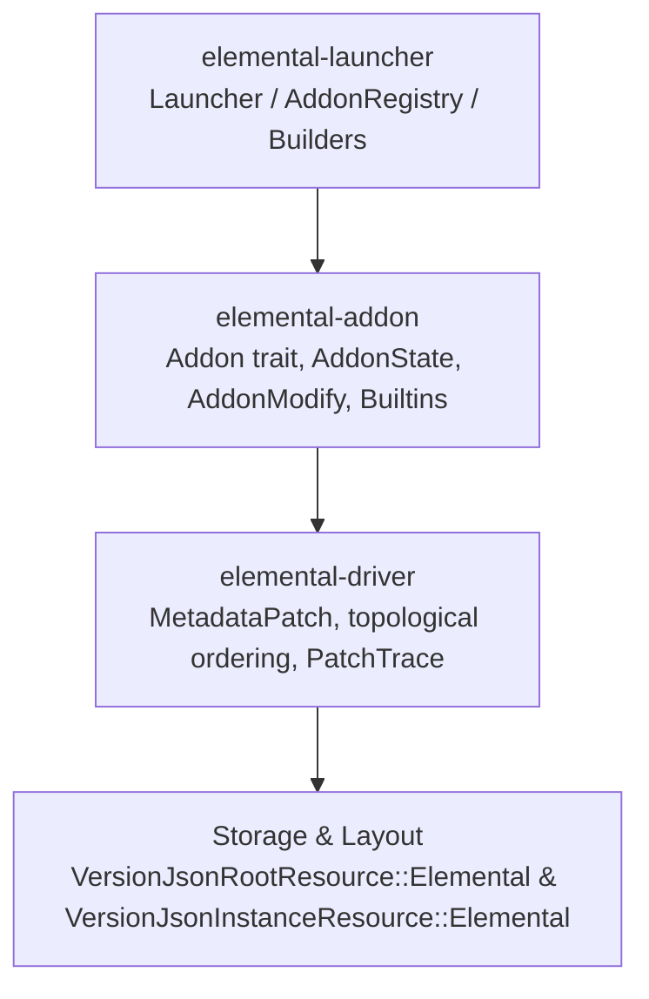

# Using Addons

Elemental separates **host drivers** (`Vanilla`, `Forge`, `Fabric`, `NeoForge`, etc.) from **composable addons** (`LiteLoader`, `authlib-injector`, OptiFine/tweaker layers, custom JVM agents, and declarative metadata overlays).

An instance has exactly one host driver, and any number of addons layered on top of it—either persisted in `.elemental/addons.json` or attached ephemerally for a single launch.

## Architecture at a Glance



- **Non-destructive by default (`PatchMode::Virtual` / `vpatch`)**: leaves `<instance>.json` untouched and overlays patches in memory from a clean baseline when building `LaunchCommand`.
- **Optional physical materialization (`PatchMode::Physical` / `patch`)**: backs up `<instance>.json` to `.elemental/base-version.json` and writes the merged metadata to disk for compatibility with external launchers. Switching back to `Virtual` restores the original `<instance>.json`.
- **Host-aware**: addons declare compatibility against the host driver and game version, and `InstanceProbe` reads `.elemental/base-version.json` first so physical patches never break host driver detection.

## Built-in Addons and Feature Flags

| Addon | ID | Feature Flag (`elemental-launcher`) | Patch Mode Support | Notes |
| - | - | - | - | - |
| `LiteLoaderAddon` | `"liteloader"` | `addon-liteloader` (on by default via `addon-all`) | `Both` | Compatible with Vanilla and Forge; supports catalog queries, external inspection, library downloads, and tweaker patches. |
| `AuthlibInjectorAddon` | `"authlib-injector"` | `yggdrasil-auth` (+ optional embedded JAR via `elemental-addon/authlib-injector-embed`) | `VirtualOnly` | Requires runtime hook; caches versioned JARs under `VersionJsonRootResource::Elemental("authlib-injector/...")` and injects `-javaagent` when `Credential::auth_server` is set. |
| `CustomPatchAddon` | custom | always enabled | `Both` | Wraps any declarative `MetadataPatch` with optional host-driver allowlist (`with_allowed_drivers`). |
| `JvmAgentAddon` | custom | always enabled | `VirtualOnly` | Reusable `-javaagent` injector (`with_agent_option`, `with_extra_jvm_arguments`) with runtime hook. |

## 1. Querying the Addon Catalog

Registered addons are accessible via `launcher.addons()` (`AddonRegistry`):

```rust
use elemental_core::minecraft::MinecraftVersionId;
use elemental_driver::descriptors::VANILLA_DRIVER;
use elemental_launcher::{AddonCatalogQuery, Launcher};

let launcher = Launcher::builder().storage_root(".minecraft").build();

// List all registered addons
for descriptor in launcher.addons().descriptors() {
    println!("{} ({})", descriptor.id, descriptor.name);
}

// Query supported game versions and releases for a built-in or third-party addon
let liteloader = launcher.addons().addon("liteloader")?;
if let Some(games) = liteloader.supported_game_versions().await? {
    println!("Supported MC versions: {}", games.len());
}

let mc_1_12_2 = MinecraftVersionId::from("1.12.2");
let query = AddonCatalogQuery::new()
    .with_driver(VANILLA_DRIVER)
    .with_game_version(&mc_1_12_2);

if let Some(releases) = liteloader.available_versions(&query).await? {
    for release in releases {
        println!("LiteLoader {}", release.version);
    }
}
```

Addons without a version catalog (such as `CustomPatchAddon` or `JvmAgentAddon`) return `Ok(None)` from `supported_game_versions()` and `available_versions(...)`.

## 2. Installing Persistent Addons

### During Instance Preparation

Use `launcher.prepare_instance(...)` to prepare the host driver and install addons in one `DownloadSession`:

```rust
use elemental_launcher::{AddonSpec, DriverSpec, Launcher, PatchMode};
use elemental_core::minecraft::MinecraftVersionId;

let prepared = launcher
    .prepare_instance("1.12.2-liteloader", DriverSpec::vanilla(MinecraftVersionId::from("1.12.2")))
    .patch_mode(PatchMode::Virtual)
    .addon(AddonSpec::new("liteloader").with_version("1.12.2-SNAPSHOT"))
    .run()
    .await?;
```

### Onto an Existing Instance

Use `launcher.install_addons(...)` when the instance already exists on disk—you do not need to re-specify `DriverSpec`:

```rust
let prepared = launcher
    .install_addons("1.12.2-vanilla")
    .addon(AddonSpec::new("liteloader").with_version("1.12.2-SNAPSHOT"))
    .run()
    .await?;
```

## 3. Patch Modes: `Virtual` (`vpatch`) vs `Physical` (`patch`)

Patch modes follow **monotonic tightening**:

1. An instance has an upper-bound policy (`PatchMode::Virtual` by default, or `PatchMode::Physical`).
2. Each `AddonSpec` defaults to `AddonPatchMode::Inherit`, or can explicitly request `AddonPatchMode::Virtual` / `AddonPatchMode::Physical`.
3. Under a `Virtual` instance policy, no addon may resolve to `Physical` (fails with `PatchModeDisallowedByInstance`).
4. Under a `Physical` instance policy, individual addons can still tighten down to `Virtual` (and `VirtualOnly` addons such as `AuthlibInjectorAddon` automatically resolve to `Virtual`).

```rust
use elemental_launcher::{AddonPatchMode, AddonSpec, PatchMode};

// Instance policy = Physical; tweaker stays Physical while debug flag stays Virtual.
let prepared = launcher
    .install_addons("my-instance")
    .patch_mode(PatchMode::Physical)
    .addon(AddonSpec::new("my-tweaker"))
    .addon(AddonSpec::new("debug-flag").with_patch_mode(AddonPatchMode::Virtual))
    .run()
    .await?;

// Switch the instance back to Virtual losslessly: restores <instance>.json from
// .elemental/base-version.json and deletes the backup.
let trace = launcher
    .set_instance_patch_mode("my-instance", PatchMode::Virtual)
    .await?;
```

You can also adjust a single addon's preference later:

```rust
launcher
    .set_addon_patch_mode("my-instance", "my-tweaker", AddonPatchMode::Virtual)
    .await?;
```

## 4. Launch-Scoped (Ephemeral) Addons

Use `launcher.launch_prepared(&prepared, &credential)` to attach addons for a single launch without writing `.elemental/addons.json` or `<instance>.json`:

- `.addon(AddonSpec)` resolves a registered addon from `Launcher::addons()`.
- `.with_addon(addon, version)` or `.with_addon_mode(addon, version, mode)` attaches an unregistered addon instance directly.
- Launch-scoped addons run under an ephemeral `PatchMode::Virtual` policy (requesting `AddonPatchMode::Physical` is rejected).
- Persistent and launch-scoped patches are merged together from the clean baseline using unified topological sorting (`before`, `after`, `priority`).

```rust
use elemental_launcher::{AddonSpec, CustomPatchAddon, MetadataPatch, addon_kit::PistonMetaGenericArgument};

let extra_flag = CustomPatchAddon::new(
    "ephemeral-flag",
    "Ephemeral Flag",
    MetadataPatch {
        jvm_arguments: vec![PistonMetaGenericArgument::Plain("-Ddev.mode=true".to_owned())],
        ..Default::default()
    },
);

// Preview the unified PatchTrace without launching
let trace = launcher
    .launch_prepared(&prepared, &credential)
    .addon(AddonSpec::new("authlib-injector"))
    .with_addon(extra_flag.clone(), None)
    .trace()
    .await?;

// Or build the LaunchCommand / spawn the JVM directly
let launched = launcher
    .launch_prepared(&prepared, &credential)
    .addon(AddonSpec::new("authlib-injector"))
    .with_addon(extra_flag, None)
    .run()
    .await?;
```

## 5. Inspecting Diffs, Reordering, Removing, and In-Memory Previews (`AddonModify`)

### Direct One-Shot Operations

```rust
// List installed + externally detected addons on an instance
let addons = launcher.instance_addons("my-instance").await?;

// Inspect step-by-step metadata diffs
let trace = launcher.trace_instance_patches("my-instance").await?;
for step in &trace.steps {
    println!(
        "{} ({:?}): +libs={:?}, -libs={:?}, main_class={:?}",
        step.id, step.effective_mode, step.added_libraries, step.removed_libraries, step.main_class
    );
}

// Persist a new addon order and re-sync patches
let reordered = launcher
    .reorder_addons("my-instance", &["addon-b", "addon-a"])
    .await?;

// Remove an addon, delete its managed_files, and re-sync remaining patches
let removed = launcher.remove_addon("my-instance", "addon-a").await?;
```

### Interactive Transaction Drafts (`AddonModify`)

For UI editors or batch changes, `launcher.modify_instance_addons(name)` loads an in-memory `AddonModify` draft. Zero disk writes occur until `commit()` is called:

```rust
let mut modify = launcher.modify_instance_addons("my-instance").await?;

// Preview reorder and mode changes purely in memory
let preview = modify.reorder(&["addon-b", "addon-a"])?;
modify.set_instance_patch_mode(PatchMode::Physical)?;
modify.set_addon_patch_mode("addon-a", AddonPatchMode::Virtual)?;

// Optionally overlay ephemeral patches on top of the draft without mutating it
let extra_preview = modify.trace_with_extra(&[])?;

// Roll back to the clean on-disk state if cancelled, or commit atomically
if user_cancelled {
    modify.discard()?;
} else {
    let committed_trace = modify.commit().await?;
    println!("Committed {} steps", committed_trace.steps.len());
}
```

## 6. Authoring and Registering Custom Addons

For declarative metadata overlays or `-javaagent` wrappers, prefer the built-in templates `CustomPatchAddon` and `JvmAgentAddon`:

```rust
use elemental_driver::descriptors::VANILLA_DRIVER;
use elemental_launcher::{
    CustomPatchAddon, JvmAgentAddon, Launcher, MetadataPatch,
    addon_kit::PistonMetaGenericArgument,
};

let optifine_patch = CustomPatchAddon::new(
    "optifine-custom",
    "OptiFine Custom",
    MetadataPatch {
        priority: 10,
        main_class: Some("net.minecraft.launchwrapper.Launch".to_owned()),
        game_arguments: vec![
            PistonMetaGenericArgument::Plain("--tweakClass".to_owned()),
            PistonMetaGenericArgument::Plain("optifine.OptiFineTweaker".to_owned()),
        ],
        ..Default::default()
    },
)
.with_version("HD_U_I6")
.with_allowed_drivers(vec![VANILLA_DRIVER.id]);

let agent = JvmAgentAddon::new("acme-agent", "Acme Agent", "/path/to/agent.jar")
    .with_version("1.0.0")
    .with_agent_option("mode=prod");

let launcher = Launcher::builder()
    .storage_root(".minecraft")
    .build()
    .register_addon(optifine_patch)?
    .register_addon(agent)?;
```

For full control (remote catalogs, external instance detection, custom artifact downloads, or dynamic launch arguments), implement `Addon` directly:

```rust
use async_trait::async_trait;
use elemental_launcher::{
    Addon, AddonDescriptor, AddonLaunchArgs, AddonLaunchContext, PatchModeSupport,
    addon_kit::Result,
};

struct MyDynamicAddon;

#[async_trait]
impl Addon for MyDynamicAddon {
    fn descriptor(&self) -> AddonDescriptor {
        AddonDescriptor::new("my-dynamic-addon", "My Dynamic Addon")
    }

    fn patch_mode_support(&self) -> PatchModeSupport {
        PatchModeSupport::VirtualOnly
    }

    fn requires_runtime_hook(&self) -> bool {
        true
    }

    async fn augment_launch(
        &self,
        args: &mut AddonLaunchArgs,
        ctx: &AddonLaunchContext<'_>,
    ) -> Result<()> {
        args.extra_jvm_arguments
            .push(format!("-Dplayer={}", ctx.credential.username));
        Ok(())
    }
}
```

### Data-Only Degradation vs Runtime Hooks

- **`requires_runtime_hook() == false` (default)**: the addon's `MetadataPatch` is serialized into `.elemental/addons.json`. Another `Launcher` that does not have that third-party `Addon` registered can still load and launch the instance cleanly.
- **`requires_runtime_hook() == true`**: `augment_launch` must run in code on every launch. If a `Launcher` loads an instance containing an unregistered runtime-hook addon, `load_instance` fails explicitly with `Error::AddonNotRegistered` instead of launching silently without the hook.

## 7. Storage and Layout Integration

Addon paths are resolved through the active `Storage` and `Layout` traits rather than hardcoded `.join(".elemental")` paths:

- **Instance-scoped files** (such as `.elemental/addons.json` and `.elemental/base-version.json`) resolve through `VersionJsonInstanceResource::Elemental(...)`.
- **Root-scoped shared caches** (such as `.elemental/authlib-injector/authlib-injector-<version>.jar`) resolve through `VersionJsonRootResource::Elemental(...)` via `instance.try_get_parent_resource(...)` or `game_storage.try_get_resource(...)`.
