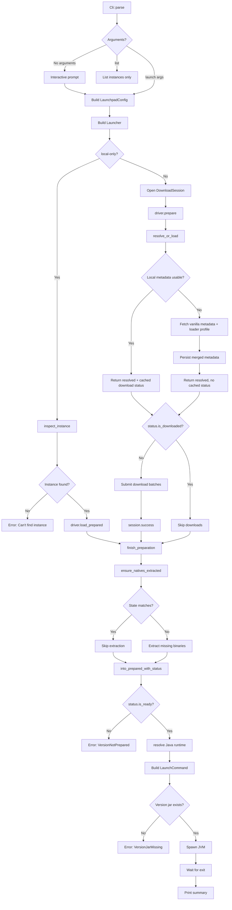

# Launch Flow

This document describes how Elemental prepares and launches a Minecraft
instance, from the `launchpad` entry point to the spawned JVM process. It also
lists the checks performed at each step and the behavior branches developers
should preserve.

The flow below reflects the `version_json` driver family, which owns vanilla,
Fabric-based, and installer-based instances. Annotations in the code excerpts
are explanatory comments added for this document; the referenced source files
remain the source of truth.

## End-to-End Overview



## 1. CLI Entry and Configuration

`crates/launchpad/src/main.rs:23` dispatches the parsed invocation. With no
launch arguments, the interactive wizard collects the same data as the
non-interactive CLI and produces a `LaunchpadConfig`.

The CLI resolves defaults and decides between the three invocation modes:

```rust
// crates/launchpad/src/cli/mod.rs:13
pub fn into_invocation(self) -> Result<Invocation> {
    // Default storage root when the user does not pass --storage-root.
    let storage_root = self
        .storage_root
        .unwrap_or_else(|| PathBuf::from(".minecraft"));

    // `list` is a read-only discovery command; it never prepares or launches.
    if matches!(self.command, Some(args::LaunchpadCliCommand::List)) {
        return Ok(Invocation::Command(LaunchpadCommand::ListInstances {
            storage_root,
        }));
    }

    // No launch arguments means the interactive setup path.
    if self.launch.is_empty() {
        return Ok(Invocation::Interactive {
            storage_root,
            local_only: self.local_only,
        });
    }

    // Otherwise build a fully specified launch request.
    Ok(Invocation::Command(LaunchpadCommand::Launch(Box::new(
        launch::build(storage_root, self.local_only, self.launch)?,
    ))))
}
```

Behavior branches:

- `list`: discovery only, no preparation and no launch.
- No launch arguments: interactive prompt, then the same preparation path.
- Launch arguments: non-interactive launch.
- `--local-only`: skip network preparation and load an already installed
  instance.

## 2. Building the Launcher

The launcher owns storage discovery, driver resolution, the downloader, and the
Java runtime resolver. Custom runtime paths are registered before the default
providers so they win lookup priority.

```rust
// crates/launchpad/src/commands.rs:56
fn build_launcher(config: &LaunchpadConfig) -> Result<Launcher> {
    // Collect user-provided runtime providers first (highest priority).
    let mut providers = Vec::<Arc<dyn RuntimeProvider>>::new();
    if !config.runtime_paths.is_empty() {
        providers.push(Arc::new(new_custom_provider(config.runtime_paths.clone())?));
    }
    // Append default providers as fallbacks.
    providers.extend(default_providers());

    Ok(Launcher::builder()
        .storage_root(config.storage_root.clone())
        .runtime_providers(providers)
        .build())
}
```

## 3. Instance Detection and Driver Selection

Instance detection probes every registered driver and keeps the returned
descriptor. Vanilla is probed last so a Fabric, Forge, or other specific driver
can claim the instance first.

```rust
// crates/launcher/src/launcher.rs:394
fn inspect_drivers(&self) -> Result<Vec<Box<dyn Driver<L, VL>>>> {
    [
        FABRIC_DRIVER,
        LEGACY_FABRIC_DRIVER,
        BABRIC_DRIVER,
        QUILT_DRIVER,
        LITELOADER_DRIVER,
        RIFT_DRIVER,
        FORGE_DRIVER,
        CLEANROOM_DRIVER,
        OUTLANDS_DRIVER,
        NEOFORGE_DRIVER,
        // Vanilla is last so more specific drivers take precedence.
        VANILLA_DRIVER,
    ]
    .into_iter()
    .map(|descriptor| self.resolve_driver(descriptor))
    .collect()
}
```

For an explicit launch, `driver.prepare` resolves the concrete driver from the
`DriverSpec` and delegates to the version JSON driver:

```rust
// crates/launcher/src/launcher.rs:175
pub(crate) async fn prepare_in_session(
    &self,
    session: &DownloadSession,
    instance_name: String,
    driver: DriverSpec,
    runtime_options: &RuntimeOptions,
) -> Result<PreparedInstance<L, VL>> {
    // Create or locate the instance directory before any driver work.
    let instance = self
        .game_storage()
        .ensure_instance(instance_name, self.instance_layout.clone())
        .await?;
    // Translate the user-facing driver spec into a concrete driver.
    let resolved_driver = self.resolve_driver(driver.descriptor())?;
    let prepared = resolved_driver
        .prepare(&PrepareRequest {
            session,
            instance: &instance,
            game_version: driver.game_version(),
            loader_version: driver.loader_version(),
            runtime_options,
            runtime_resolver: &self.runtime_resolver,
        })
        .await?;
    Ok(PreparedInstance::new(driver.descriptor(), prepared))
}
```

The caller must finish the download session. The public
`prepare_with_session` wrapper always finishes the session and fails if the
session report is not successful (`crates/launcher/src/launcher.rs:155`).

## 4. Preparation Branches

`prepare_instance` has two mutually exclusive paths.

```rust
// crates/launchpad/src/commands.rs:69
async fn prepare_instance(
    launcher: &Launcher,
    config: &LaunchpadConfig,
) -> Result<(PreparedInstance, Duration)> {
    if config.local_only {
        // Local-only never opens a download session.
        let instance = launcher
            .inspect_instance(config.instance_name.clone())
            .await?
            .context("Can't find instance")?;
        let started_at = Instant::now();
        // Load metadata from disk and run the same finishing checks as online
        // preparation. This still ensures natives are extracted.
        let prepared = progress::with_spinner(
            "Loading prepared instance",
            launcher.load_instance(instance),
        )
        .await?;
        Ok((prepared, started_at.elapsed()))
    } else {
        // Online preparation opens a session and reports progress.
        let session = launcher
            .downloader()
            .session(format!("prepare {}", config.instance_name))
            .open()
            .await?;
        let _download_progress = progress::download(&session).await?;
        let started_at = Instant::now();
        let prepared = launcher
            .prepare_with_session(
                session,
                config.instance_name.clone(),
                config.spec.clone(),
                &config.runtime,
            )
            .await?;
        Ok((prepared, started_at.elapsed()))
    }
}
```

Both branches converge on `finish_preparation`, so natives handling is
identical whether the instance was just downloaded or was already present.

## 5. Loading or Refreshing Metadata

Online preparation first tries the local instance. A local instance is reused
only when both conditions hold:

1. `download_status().is_downloaded()` is true.
2. The family does not report that local metadata needs a refresh for the
   requested game/loader version.

The computed download status is returned to the caller so `prepare` can reuse it
instead of scanning every artifact and asset a second time. Otherwise Elemental
resolves vanilla metadata, applies the loader profile, and persists the merged
result.

```rust
// crates/driver/src/families/version_json/driver/resolve.rs:18
pub(super) async fn resolve_or_load<L, VL>(
    &self,
    instance: &Storage<VL, Storage<L>>,
    game_version: MinecraftVersionId,
    loader_version: LoaderVersionId,
) -> Result<(
    ResolvedVersionJsonInstance<F::RemoteResolver, L, VL>,
    Option<VersionJsonDownloadStatus>,
)>
where
    L: VersionJsonRootLayout + Clone,
    VL: VersionJsonInstanceLayout + Clone,
{
    // Loading can fail when metadata or the asset index is absent/corrupt.
    if let Ok(resolved) =
        ResolvedVersionJsonInstance::load(self.remote_resolver(), instance.clone())
    {
        // Download status is a pure read and excludes natives.
        let status = resolved.download_status().await?;
        if status.is_downloaded()
            && !self.family.local_metadata_needs_refresh(
                &resolved.metadata,
                &game_version,
                &loader_version,
            )
        {
            // Return the status so prepare does not repeat the same scan.
            return Ok((resolved, Some(status)));
        }
    }

    // Local data is missing, incomplete, or stale: fetch and persist metadata.
    let resolved = self
        .resolve_metadata(game_version, loader_version)
        .await?
        .persist(instance)
        .await?;
    // Freshly persisted metadata has no reusable download status yet.
    Ok((resolved, None))
}
```

Branches:

- Local metadata loads and is complete and current: no network metadata work,
  and the download status is reused by `prepare`.
- Local metadata loads but is incomplete: resolve and persist metadata.
- Local metadata cannot be loaded (missing or malformed): resolve and persist
  metadata.
- Local metadata is complete but stale for the requested loader/game version:
  resolve and persist metadata.

## 6. Readiness Model

Download readiness is represented by four independent booleans. Install
readiness adds natives as a fifth boolean.

```rust
// crates/driver/src/families/version_json/prepared/status.rs:2
pub struct VersionJsonDownloadStatus {
    // The version JSON itself is present.
    pub metadata_persisted: bool,
    // The asset index JSON is present.
    pub asset_index_persisted: bool,
    // The version jar and every required library artifact are present.
    pub version_artifacts_ready: bool,
    // Every object referenced by the asset index is present.
    pub assets_ready: bool,
}

impl VersionJsonDownloadStatus {
    pub fn is_persisted(&self) -> bool {
        // Metadata plus asset index is the minimum "known instance" state.
        self.metadata_persisted && self.asset_index_persisted
    }

    pub fn is_downloaded(&self) -> bool {
        // Downloads are complete only when artifacts and assets are present.
        self.is_persisted() && self.version_artifacts_ready && self.assets_ready
    }

    pub fn with_natives_extracted(self, natives_extracted: bool) -> VersionJsonInstallStatus {
        // Combine an already verified download state with the natives result.
        VersionJsonInstallStatus {
            metadata_persisted: self.metadata_persisted,
            asset_index_persisted: self.asset_index_persisted,
            version_artifacts_ready: self.version_artifacts_ready,
            assets_ready: self.assets_ready,
            natives_extracted,
        }
    }
}

// crates/driver/src/families/version_json/prepared/status.rs:30
pub struct VersionJsonInstallStatus {
    pub metadata_persisted: bool,
    pub asset_index_persisted: bool,
    pub version_artifacts_ready: bool,
    pub assets_ready: bool,
    // Native binaries are extracted and match the recorded state.
    pub natives_extracted: bool,
}

impl VersionJsonInstallStatus {
    pub fn download_status(&self) -> VersionJsonDownloadStatus {
        // Project the install status onto its download-related fields.
        VersionJsonDownloadStatus {
            metadata_persisted: self.metadata_persisted,
            asset_index_persisted: self.asset_index_persisted,
            version_artifacts_ready: self.version_artifacts_ready,
            assets_ready: self.assets_ready,
        }
    }

    pub fn is_persisted(&self) -> bool {
        self.download_status().is_persisted()
    }

    pub fn is_downloaded(&self) -> bool {
        self.download_status().is_downloaded()
    }

    pub fn is_ready(&self) -> bool {
        // Launch readiness additionally requires extracted natives.
        self.is_downloaded() && self.natives_extracted
    }
}
```

`download_status()` and `status()` perform only existence checks. They never
write files and never start extraction. `download_status()` is the reusable
expensive part; `status()` adds one cheap natives state comparison on top.

```rust
// crates/driver/src/families/version_json/prepared/readiness.rs:23
pub async fn download_status(&self) -> Result<VersionJsonDownloadStatus> {
    // The rule context filters libraries by OS/arch/features.
    let rule_context = VersionJsonRuleContext::current();
    Ok(VersionJsonDownloadStatus {
        metadata_persisted: self
            .version
            .try_get_resource(VersionJsonInstanceResource::Metadata)?
            .exists(),
        asset_index_persisted: self
            .version
            .parent
            .try_get_resource(VersionJsonRootResource::AssetIndexes(Some(
                SafeRelativePath::parse(self.metadata.asset_index.id.as_str())?,
            )))?
            .exists(),
        version_artifacts_ready: self.version_artifacts_ready(&rule_context)?,
        assets_ready: self.assets_ready()?,
    })
}

// crates/driver/src/families/version_json/prepared/readiness.rs:42
pub async fn status(&self) -> Result<VersionJsonInstallStatus> {
    let download_status = self.download_status().await?;
    // Reuse the metadata already held in memory instead of re-reading the JSON.
    let natives_extracted = natives_are_extracted(&self.version, &self.metadata).await?;
    Ok(download_status.with_natives_extracted(natives_extracted))
}
```

Artifact checks are presence-based, not content-based:

```rust
// crates/driver/src/families/version_json/prepared/readiness/artifacts.rs:21
pub(super) fn version_artifacts_ready(
    &self,
    rule_context: &VersionJsonRuleContext,
) -> Result<bool> {
    // The client jar must exist.
    if !self
        .version
        .try_get_resource(VersionJsonInstanceResource::Jar)?
        .exists()
    {
        return Ok(false);
    }
    // Every library artifact allowed by the current rules must exist.
    if !self.libraries_ready(rule_context)? {
        return Ok(false);
    }
    Ok(true)
}

fn libraries_ready(&self, rule_context: &VersionJsonRuleContext) -> Result<bool> {
    // Collect only libraries that pass the current rule context.
    let mut artifact_paths = Vec::new();
    for library in self
        .metadata
        .libraries
        .iter()
        .filter(|library| library.is_allowed(rule_context))
    {
        for artifact in library.version_artifacts(rule_context.platform())? {
            artifact_paths.push(SafeRelativePath::parse(artifact.path.as_str())?);
        }
    }
    // Verify presence without hashing or inspecting file contents.
    library_artifacts_present(&self.version.parent, artifact_paths)
}
```

Every asset object is checked by existence only
(`crates/driver/src/families/version_json/prepared/readiness.rs:48`).

### Why There Is No Forced SHA1 Check

Readiness is deliberately based on existence. Users and tools may replace
native binaries or library files for legitimate reasons (diagnostics, modded
runtimes, platform workarounds), and hashing every artifact on every launch is
expensive. Content verification belongs to an explicit repair or integrity
command, not to the normal launch path.

## 7. Natives

Natives are handled during `finish_preparation`, after downloads and before the
`is_ready` assertion. The download status already computed by the caller is
carried forward, so artifact and asset existence is not scanned again.

```rust
// crates/driver/src/families/version_json/prepared/instance/prepare.rs:21
pub async fn prepare(
    self,
    session: &DownloadSession,
) -> Result<PreparedVersionJsonInstance<L, VL>> {
    // Public entry point has no cached status; compute it inside.
    self.prepare_with_download_status(session, None).await
}

// crates/driver/src/families/version_json/prepared/instance/prepare.rs:28
pub(crate) async fn prepare_with_download_status(
    self,
    session: &DownloadSession,
    download_status: Option<VersionJsonDownloadStatus>,
) -> Result<PreparedVersionJsonInstance<L, VL>> {
    let download_status = match download_status {
        // Reuse the scan performed by resolve_or_load when it is complete.
        Some(status) if status.is_downloaded() => status,
        // Otherwise compute once, download if needed, then compute again.
        _ => self.download_missing(session).await?,
    };
    self.finish_preparation_with_download_status(download_status)
        .await
}

// crates/driver/src/families/version_json/prepared/instance/prepare.rs:41
async fn download_missing(
    &self,
    session: &DownloadSession,
) -> Result<VersionJsonDownloadStatus> {
    let status = self.download_status().await?;
    if status.is_downloaded() {
        return Ok(status);
    }
    self.submit_install_batches(session).await?;
    session.success().await?;
    // Recompute only after new files may have landed.
    self.download_status().await
}

// crates/driver/src/families/version_json/prepared/instance/prepare.rs:61
pub async fn finish_preparation(self) -> Result<PreparedVersionJsonInstance<L, VL>> {
    // Local-only and installer paths enter here without a cached status.
    let download_status = self.download_status().await?;
    self.finish_preparation_with_download_status(download_status)
        .await
}

// crates/driver/src/families/version_json/prepared/instance/prepare.rs:67
async fn finish_preparation_with_download_status(
    self,
    download_status: VersionJsonDownloadStatus,
) -> Result<PreparedVersionJsonInstance<L, VL>> {
    // Exactly one natives state comparison; no repeated asset scan.
    ensure_natives_extracted(&self.version, &self.metadata).await?;
    // Extraction success proves natives are present, so no second scan.
    self.into_prepared_with_status(download_status.with_natives_extracted(true))
        .await
}
```

```rust
// crates/driver/src/families/version_json/storage/natives.rs:27
pub(crate) async fn natives_are_extracted<L, VL>(
    storage: &Storage<VL, Storage<L>>,
    metadata: &PistonMetaData,
) -> Result<bool> {
    // Metadata comes from memory; the version JSON is not re-read here.
    let expected = expected_natives(storage, metadata)?;
    // Older versions without native libraries are trivially ready.
    if expected.native_artifacts.is_empty() {
        return Ok(true);
    }
    let store = natives_state_store(&storage.path).await?;
    // Compare the recorded state with the expected state.
    Ok(natives_state_matches(
        &store.cloned().await.value,
        &expected,
    ))
}

// crates/driver/src/families/version_json/storage/natives.rs:47
pub(crate) async fn ensure_natives_extracted<L, VL>(
    storage: &Storage<VL, Storage<L>>,
    metadata: &PistonMetaData,
) -> Result<()> {
    // Fast path: a matching state record avoids filesystem extraction.
    if natives_are_extracted(storage, metadata).await? {
        return Ok(());
    }
    extract_natives_with_metadata(storage, metadata).await
}
```

The state match is intentionally structural and cheap. It compares the
destination, the sorted native artifact list, and the existence of every
previously extracted relative path. It does not compare hashes or sizes.

```rust
// crates/driver/src/families/version_json/storage/natives/state.rs:74
pub(super) fn natives_state_matches(
    state: &NativesState,
    expected: &NativesExpectation,
) -> bool {
    !state.path.is_empty()
        // The natives directory must be the one expected by the current layout.
        && state.path == expected.destination.to_string_lossy()
        // The native artifact set must be unchanged.
        && state.native_artifacts == expected.native_artifacts
        // Every file recorded during extraction must still exist.
        && (expected.native_artifacts.is_empty()
            || (!state.extracted_files.is_empty()
                && state
                    .extracted_files
                    .iter()
                    .all(|file| expected.destination.join(file).exists())))
}
```

Extraction rules:

- Only binary extensions are extracted: `dll`, `so`, `dylib`, `jnilib`
  (`crates/driver/src/families/version_json/storage/natives/directory.rs:38`).
- Entries listed in the library's `extract.exclude` are skipped.
- Existing files are not overwritten; only missing files are written
  (`JarFile::extract_missing_blocking`).
- Relative paths inside the jar are preserved, so nested native layouts remain
  intact.
- After extraction, the directory is scanned recursively and the actual
  relative binary paths are recorded in `.elemental/natives.json`.

```rust
// crates/driver/src/families/version_json/storage/natives.rs:103
fn extract_native_library<L, VL>(
    storage: &Storage<VL, Storage<L>>,
    artifact: &PistonMetaLibrariesDownloadsArtifact,
    destination: &Path,
    exclude: &[String],
) -> Result<()> {
    // Resolve the native jar from the libraries root.
    let path = SafeRelativePath::parse(artifact.path.as_str())?;
    let source = storage
        .parent
        .try_get_resource(VersionJsonRootResource::Libraries(Some(path)))?;
    JarFile::new(source)
        // Copy only missing entries that are binaries and not excluded.
        .extract_missing_blocking(destination, |relative_path| {
            NativesDirectory::is_binary(relative_path)
                && !is_excluded_relative_path(relative_path, exclude)
        })
        .map(|_| ())
        .map_err(Error::from)
}
```

### Natives Directory Selection

The instance layout first checks for an existing directory using this order
(`crates/driver/src/families/version_json/layout/instance.rs:28`):

1. `natives-<os>-<arch>` (Elemental platform default).
2. `natives` (Prism and older Elemental layouts).
3. `<instance-name>-natives` (PCL/XMCL layouts).

If none exist, the platform default is used for new extraction. This keeps
other launchers' layouts working without modifying them.

## 8. Java Runtime Resolution

The runtime is chosen after the instance is fully prepared, because the required
Java major version comes from the version metadata.

```rust
// crates/driver/src/launch/mod.rs:14
pub async fn resolve_prepared_version_runtime<L, VL>(
    prepared_version: &PreparedVersionJsonInstance<L, VL>,
    runtime_options: &RuntimeOptions,
    runtime_resolver: &RuntimeResolver,
) -> Result<Distribution>
where
    L: VersionJsonRootLayout,
    VL: VersionJsonInstanceLayout,
{
    // An explicit override wins; otherwise use metadata's javaVersion.majorVersion.
    let required_major_version = runtime_options
        .runtime_major_version
        .unwrap_or_else(|| prepared_version.required_java_major_version());

    if let Some(distribution) = runtime_options.runtime_override.as_ref() {
        // Overrides are validated for compatibility before use.
        distribution
            .require_compatible(required_major_version, runtime_options.runtime_validation)?;
        return Ok(distribution.clone());
    }

    // Otherwise ask the provider chain to resolve the required major version.
    Ok(runtime_resolver.resolve(required_major_version).await?)
}
```

Branches:

- Explicit runtime override: validate compatibility, then use it.
- No override: resolve from custom providers first, then defaults.
- No compatible runtime: fail before building the command.

## 9. Building the Launch Command

Command construction reads metadata, resolves every path, and produces a
`LaunchCommand`. It does not download or extract anything.

```rust
// crates/driver/src/families/version_json/builder/command.rs:19
pub fn build_command(mut self) -> Result<LaunchCommand> {
    // Metadata must be readable; this is a required pre-launch check.
    let metadata = self
        .version
        .metadata()
        .map_err(|source| Error::ReadVersionMetadata {
            source: Box::new(source),
        })?;
    // Rule context selects OS/arch/feature-specific libraries and arguments.
    let rule_context = VersionJsonRuleContext::current();
    // The version directory name is used by several launch variables.
    let version_name = self
        .version
        .name()
        .ok_or_else(|| Error::MissingVersionName {
            path: self.version.path.clone(),
        })?;
    // The builder is public and can be used without the readiness checks.
    let version_jar = self
        .version
        .try_get_resource(VersionJsonInstanceResource::Jar)?;
    if !version_jar.exists() {
        return Err(Error::VersionJarMissing { path: version_jar });
    }
    // Resolve version root, assets, libraries, and natives directories.
    let paths = LaunchPaths::resolve(&self.version)?;

    let credential = self.credential.clone();
    // Fill built-in variables such as game directory, assets, auth, natives.
    self.apply_default_variables(&metadata, &credential, version_name, &paths);

    // Compute module path entries before classpath filtering.
    let raw_jvm_arguments = metadata.jvm_arguments(&rule_context);
    let module_path_entries = self.collect_module_path_entries(raw_jvm_arguments.as_slice())?;
    self.inner.classpath =
        self.build_classpath(&metadata, &rule_context, &module_path_entries)?;

    // Evaluate JVM and game arguments with the current rules and variables.
    let jvm_arguments = self.build_jvm_arguments(&metadata, raw_jvm_arguments)?;
    let game_arguments = self.build_game_arguments(&metadata, &rule_context)?;

    Ok(LaunchCommand::new(
        self.runtime,
        jvm_arguments,
        metadata.main_class.clone(),
        game_arguments,
    )
    // Run the game with the version directory as the working directory.
    .with_cwd(paths.version_root))
}
```

The path object centralizes all location decisions:

```rust
// crates/driver/src/families/version_json/builder/paths.rs:22
pub(super) fn resolve<L, VL>(version: &Storage<VL, Storage<L>>) -> Result<Self>
where
    L: VersionJsonRootLayout,
    VL: VersionJsonInstanceLayout,
{
    Ok(Self {
        // Instance root, also used as the default game directory and cwd.
        version_root: resolve_absolute_path(version.path.clone())?,
        // Shared assets root and libraries root live in the game storage parent.
        assets_root: resolve_absolute_path(
            version
                .parent
                .try_get_resource(VersionJsonRootResource::Assets)?,
        )?,
        libraries_root: resolve_absolute_path(
            version
                .parent
                .try_get_resource(VersionJsonRootResource::Libraries(None))?,
        )?,
        // Natives directory selected by the instance layout.
        natives_directory: resolve_absolute_path(
            version.try_get_resource(VersionJsonInstanceResource::Natives)?,
        )?,
    })
}
```

Default variables include the `natives_directory` consumed by JVM arguments such
as `-Djava.library.path`:

```rust
// crates/driver/src/families/version_json/builder/command.rs:55
fn apply_default_variables(
    &mut self,
    metadata: &PistonMetaData,
    credential: &Credential,
    version_name: String,
    paths: &LaunchPaths,
) {
    // Preserve an explicitly configured player name.
    if self.inner.auth_player_name.is_empty() {
        self.inner.auth_player_name = credential.username.clone();
    }

    self.inner.version_name = version_name;
    // The instance directory is both the game directory and the process cwd.
    self.inner.game_directory = paths.version_root.to_string_lossy().to_string();
    self.inner.assets_root = paths.assets_root.to_string_lossy().to_string();
    self.inner.assets_index_name = metadata.assets.clone();
    self.inner.auth_uuid = credential.uuid.clone();
    self.inner.auth_access_token = credential.access_token.clone();
    // The credential kind selects the user type explicitly instead of inferring
    // it from an empty access token.
    self.inner.user_type = match credential.kind {
        CredentialKind::Legacy => UserType::Legacy,
        CredentialKind::Mojang => UserType::Mojang,
        CredentialKind::Msa => UserType::Msa,
    };
    self.inner.version_type = metadata.release_type.clone();
    self.inner.library_directory = paths.libraries_root.to_string_lossy().to_string();
    // Platform-specific classpath separator (`;` on Windows, `:` elsewhere).
    self.inner.classpath_separator = classpath_separator().to_owned();
    // Natives path resolved from the instance layout, not hard-coded.
    self.inner.natives_directory = paths.natives_directory.to_string_lossy().to_string();
}
```

## 10. Spawning the Process and Diagnostics

Before spawning, `finalize_launch` prints diagnostics, including the resolved
runtime, cwd, argument count, metadata identifiers, version jar, and the natives
directory contents (`crates/launchpad/src/commands.rs:127`).

```rust
// crates/core/src/launcher/process.rs:8
pub fn spawn_command(command: LaunchCommand) -> Result<Child> {
    let program = command.program();
    // Refuse to spawn with an empty executable path.
    if program.as_os_str().is_empty() {
        return Err(Error::EmptyExecutable);
    }

    let mut child = Command::new(&program);
    // All JVM, main class, and game arguments are already fully rendered.
    child.args(command.arguments());

    // The version root is the working directory for relative game paths.
    if let Some(cwd) = &command.cwd {
        child.current_dir(cwd);
    }

    // Apply extra environment variables collected by the command builder.
    for (key, value) in &command.env {
        child.env(key, value);
    }

    child
        .spawn()
        .map_err(|source| Error::Spawn { program, source })
}
```

After spawning, launchpad waits for the process and prints a summary with the
exit status (`crates/launchpad/src/diagnostics.rs:77`).

## 11. Check Matrix

| Stage | Check | Validation type | Failure behavior |
| --- | --- | --- | --- |
| CLI | launch arguments present | parse | interactive prompt |
| Discovery | instance directory exists | filesystem | `Can't find instance` (local-only) |
| Discovery | driver probe matches metadata | metadata shape | vanilla fallback or unsupported driver |
| Metadata | version JSON readable | parse | `ReadVersionMetadata` |
| Metadata | asset index readable | parse | resolve metadata again |
| Metadata | local metadata current | version compare | refetch vanilla + loader profile |
| Download | metadata persisted | presence | download batch |
| Download | asset index persisted | presence | download batch |
| Download | client jar present | presence | download batch |
| Download | required libraries present | presence | download batch |
| Download | asset objects present | presence | download batch |
| Download | session report | report status | preparation error |
| Natives | expected native list | metadata + rules | extract |
| Natives | state file matches | path/list/existence | extract |
| Natives | recorded files exist | presence | extract |
| Prepared | `is_ready()` | aggregate | `VersionNotPrepared` |
| Runtime | override compatibility | Java major version | compatibility error |
| Runtime | provider resolution | installed runtimes | runtime resolution error |
| Command | version name available | metadata/path | `MissingVersionName` |
| Command | client jar exists | presence | `VersionJarMissing` |
| Process | executable non-empty | path check | `EmptyExecutable` |

No stage in the normal launch path performs SHA1, size, or content comparison.
Those belong to explicit verification or repair workflows.

## 12. Invariants to Preserve

- Vanilla, loader, and other launchers' configurations are respected.
- Existing files are never overwritten during natives extraction.
- `download_status()` and `status()` are pure reads and must not trigger writes
  or downloads.
- A completed download scan is carried from `resolve_or_load` into `prepare`
  instead of being recomputed.
- Natives state checks reuse the in-memory `PistonMetaData`; they do not re-read
  the version JSON.
- `finish_preparation` is the only place that ensures natives.
- A `PreparedVersionJsonInstance` guarantees `is_ready()`, not merely
  `is_downloaded()`.
- Natives layout is resolved from the instance layout, never hard-coded in the
  command builder.
- The command builder reads paths; it does not create or modify them.
